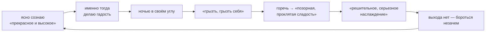
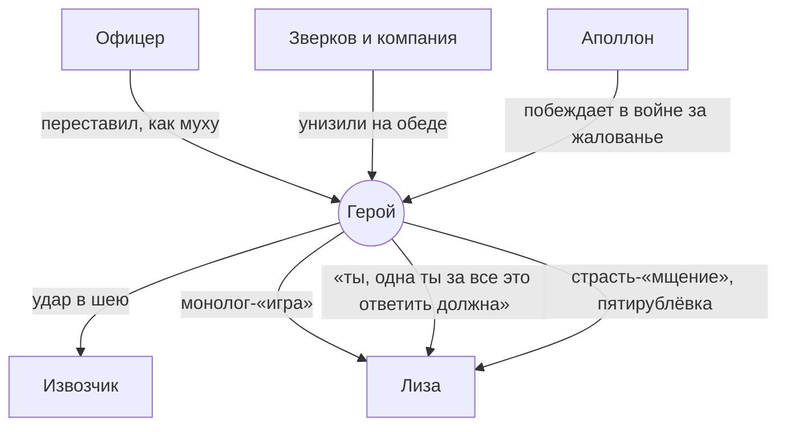
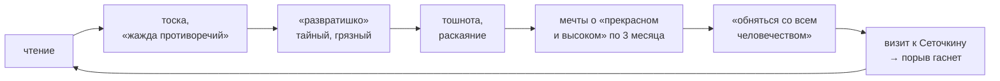

# 8 механизмов подпольной психики

Достоевский не просто описывает чувства героя. Он показывает *повторяющиеся схемы*, которые можно разложить по шагам. Здесь каждая схема разложена и найдена в сюжете.

---

## 1. Гадость → самогрызение → наслаждение
*Теория: I.2*



**В сюжете:**
- после толчка с офицером: «что произошло со мной через три дня… можете сами догадаться» (2.01 ¶20);
- после разврата: «становилось ужасно тошно… Мало-помалу я, однако же, и к этому привыкал» (2.02 ¶1);
- после обеда: «через сорок лет… с отвращением и с унижением вспомню» (2.04 ¶78).

## 2. Механизм мщения мыши
*Теория: I.3 · практика: офицер, Зверков*

| Шаг | По теории | Офицер (II.1) |
|---|---|---|
| 1 | Обида | переставил «как с мухой», не заметив |
| 2 | Злости больше, чем у быка | — |
| 3 | Не верит в справедливость мести | побоялся, что «литературный» протест не поймут |
| 4 | «Бурда» сомнений, насмешки | «озлобленно стушеваться» |
| 5 | Бегство «в свою щелочку» | ушёл |
| 6 | Годами копит злость | «укреплялась и разрасталась с годами» |
| 7 | Мелкая месть «из-за печки, инкогнито» | слежка, карикатура, неотправленное письмо, толчок плечом |
| 8 | Наслаждение в «полуотчаянии, полувере» | «отмщенный за все», итальянские арии… и расплата через три дня |

Со Зверковым всё так же. Обида на обеде, клятва дать пощёчину, «бурда» сценариев в санях. Обидчики «разошлись», и месть падает на Лизу (см. механизм 4).

## 3. Влечение к унизительной ситуации
*Обед у Зверкова, Невский*

1. Он знает, что ситуация его унизит.
2. Именно поэтому его туда тянет: «чем бестактнее… тем скорее и поеду» (2.03 ¶33).
3. Прикрывается мотивом: доказать, что не трус.
4. Его унижают на самом деле.
5. Он унижает себя ещё сильнее, демонстративно (хождение у стены).
6. Вдруг начинает молить о дружбе: «Я прошу вашей дружбы» (2.04 ¶89).

> «Для чего я набирал на себя эту муку… не знаю? но меня просто тянуло туда» (2.01 ¶18)

## 4. Перенос унижения на слабейшего
*Сквозная цепочка второй части*

> «Меня унизили, так и я хотел унизить; меня в тряпку растерли, так и я власть захотел показать…» (2.09 ¶32)



*Включать сюда извозчика — интерпретация составителя.* Лиза оказывается в конце каждой цепочки, потому что она единственная, кто стоит ниже героя и при этом ему открыта.

## 5. Сочинение жизни от скуки
*Теория: I.5*

> «Сам себе приключения выдумывал и жизнь сочинял, чтоб хоть как-нибудь да пожить.» (1.05 ¶1)

| Эпизод | Признак «сочинённости» |
|---|---|
| Идёт в биллиардную подраться | «Авось, дескать, и я подерусь, и меня тоже из окна спустят» (2.01 ¶11) |
| Напрашивается на обед | «будет даже очень красиво» (2.03 ¶10) |
| Сценарии мести в санях | «все это из Сильвио и из „Маскарада“» (2.05 ¶26) |
| Речь Лизе | «Более всего меня игра увлекала» (2.06 ¶86) |
| Пятирублёвка | жестокость «нарочно подсочиненная, книжная» (2.10 ¶6) |

## 6. Риторика власти над Лизой
*II.6–7 · техника манипуляции, по шагам*

| № | Ход | Что он думает про себя |
|---|---|---|
| 1 | Нейтральные вопросы | «чтоб поскорей кончить» |
| 2 | Образ гроба и воды в могиле (с выдумками) | «Меня вдруг что-то начало подзадоривать» |
| 3 | Прогноз падения «ниже и ниже» | «продолжал я с злорадством» |
| 4 | Сочувствие: «Тебя жаль» | её отпор «тотчас же подозлил» |
| 5 | Долг хозяйке — «цепь», рабство | «какая-то цель „явилась“» |
| 6 | «я… может быть, тоже такой же несчастный» | «это любопытно, это – сродни» |
| 7 | Поиск тона: семья, отец и дочь | «В тон надо попасть» |
| 8 | «Картинки» счастливого брака и ребёнка | «Картинками… тебя надо!» |
| 9 | Лиза: «точно как по книге» | «Постой же» |
| 10 | Монолог о гибели и похоронах | «книжность может еще больше подспорить делу» |
| 11 | Лиза в отчаянии, он «струсил» | — |

**Главная загадка:** где кончается игра и начинается чувство? «Клянусь, она и в самом деле меня интересовала… Да и плутовство ведь так легко уживается с чувством» (2.06 ¶93). «Игра, игра увлекла меня; впрочем, не одна игра…» (2.07 ¶3). Текст не отвечает.

## 7. Разврат ↔ мечтательство
*Ритм жизни в 24 года: «у меня все было полосами»*



> «в грязи я утешал себя тем, что в другое время бываю герой, а герой прикрывал собой грязь» (2.02 ¶1)

## 8. Сознание → сомнение → инерция
*Теория: I.5 · общая схема бездействия*

```
побуждение (обида, чувство)
      ↓
поиск основания, «первоначальной причины»
      ↓
каждая причина тянет «еще первоначальнее» (бесконечный регресс)
      ↓
опоры нет → злоба «разлагается», обида = «фатум»
      ↓
├─ бессильный жест: «прибить побольнее кулаком вашу стену»
└─ попытка «увлекись своим чувством слепо» → через день презрение к себе
      ↓
«мыльный пузырь и инерция» → скука → выдумывание приключений → (снова)
```

---

## Две большие схемы, если обобщить

**Рефлексия парализует действие.** Чем больше анализируешь основания, тем меньше их остаётся. Тогда действие либо не начинается, либо совершается без основания (из злости, по книжному сценарию) и тут же обесценивается.

**Унижение рождает власть.** Унижение, которое нельзя вернуть обидчику, переносится на того, кто слабее. Власть маскируется под мораль, спасение или любовь. Потом приходят разоблачение и стыд, а с ними новое унижение, и круг замыкается.
