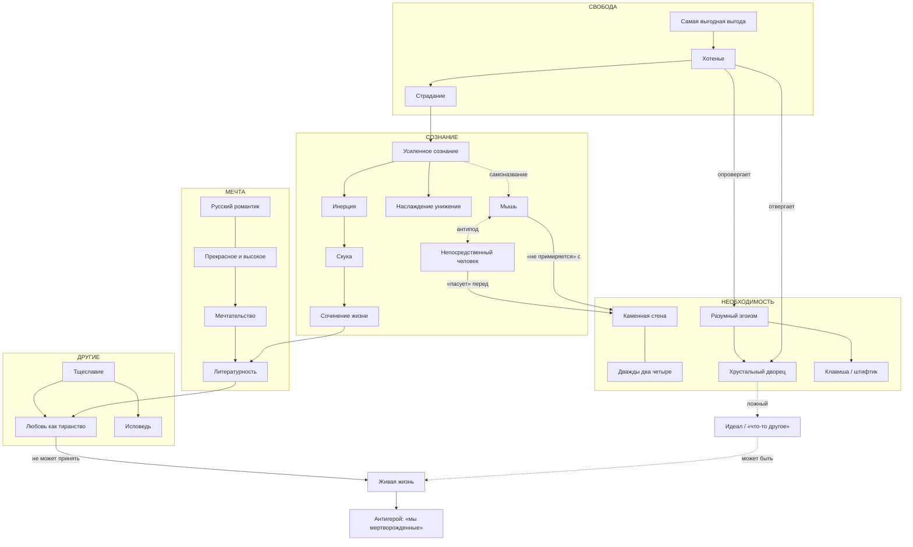
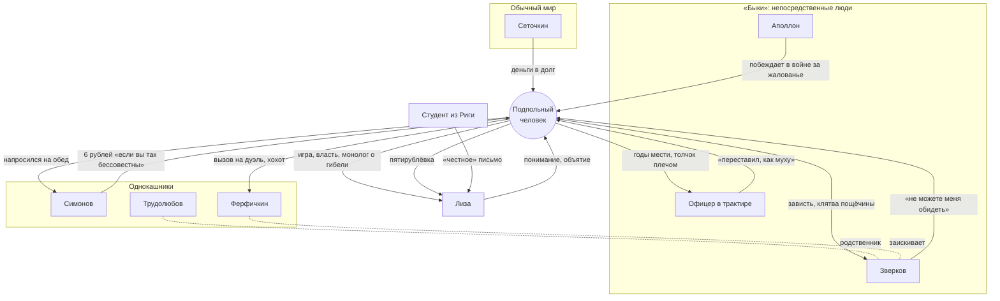

# Онтология книги: карта сущностей

Всё, из чего «собраны» «Записки из подполья», и как эти части связаны между собой.

## Из чего состоит мир книги

| Тип сущности | Сколько | Что это | Где подробно |
|---|---|---|---|
| **Персонажи** | 9 главных + 14 эпизодических | кто действует | [персонажи/](персонажи/) |
| **Понятия** | 25 | чем думает герой | [словарь понятий](словарь_понятий.md) |
| **Аргументы** | 12 | как он спорит | [аргументы](../03_Ключевые_идеи/аргументы.md) |
| **Механизмы** | 8 | как он живёт, то есть повторяющиеся схемы поведения | [механизмы](../03_Ключевые_идеи/механизмы.md) |
| **Мотивы** | 11 | образы, которые возвращаются | [темы и мотивы](../06_Анализ/темы_и_мотивы.md) |
| **Места** | 7 | Петербург героя | [темы и мотивы → Петербург](../06_Анализ/темы_и_мотивы.md#петербург) |

---

## Большая карта идей

**Как читать карту.** Внутри части I идут две большие линии. «Сознание» объясняет, почему герой не может жить. «Свобода» объясняет, почему он не хочет жить по расчёту. Обе сходятся в подполье. Часть II добавляет «Мечту» и «Других»: что происходит, когда подпольный человек выходит к людям. В конце всё упирается в «живую жизнь», которую он видит в Лизе и не может принять.

---

## Карта персонажей

---

## Как сущности распределены по частям

| | Часть I (теория) | Часть II (практика) |
|---|---|---|
| **Главные понятия** | сознание, инерция, стена, выгода, хотенье, дворец, страдание | тщеславие, мечтательство, книжность, любовь-тиранство, живая жизнь |
| **Механизмы** | описаны | разыграны |
| **Персонажи** | только «господа» и рассказчик | 9 живых людей |
| **Мотивы** | зубная боль, болезнь, «господа» | мокрый снег, муха, пощёчина, дуэль, деньги, похороны |
| **Голос** | 40-летний полемист | 40-летний рассказчик о себе 24-летнем |
