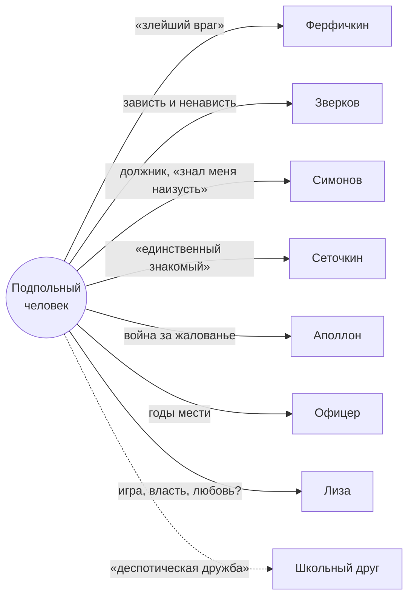

# Подпольный человек

*Рассказчик и герой. Имени у него нет. Автор называет его «парадоксалистом», сам он себя — «антигероем».*

> «ни злым, ни добрым, ни подлецом, ни честным, ни героем, ни насекомым» (1.01 ¶4)

## Досье (только то, что есть в тексте)

| | |
|---|---|
| **Возраст** | 40 лет сейчас; 24 года в событиях части II |
| **Чин** | коллежский асессор, в отставке. Служил, «чтоб было что-нибудь есть» |
| **Деньги** | год назад получил 6000 руб. по завещанию дальнего родственника и вышел в отставку |
| **Жильё** | «угол», «дрянная» комната на краю Петербурга; старая злая служанка |
| **Детство** | сирота, отдан в школу дальними родственниками |
| **Школа** | учился лучше всех, читал книги не по курсу, товарищей презирал и был ими презираем |
| **Внешность** | «человек низенький и истощенный»; своё лицо считал глупым и ненавидел |
| **Слуга (в 24)** | Аполлон, 7 лет, 7 руб. в месяц |
| **Так живёт** | «лет двадцать» |

## Как он себя называет

«больной», «злой», «непривлекательный» · «ужасно самолюбив… мнителен и обидчив, как горбун или карлик» · «трус и раб» · «деспот в душе» · «мерзавец, подлец, себялюбец, лентяй» · «эгоист».

Почти каждую из этих характеристик он потом сам оспаривает. Верить ему на слово нельзя никогда (см. [Самоопровержение](../../06_Анализ/темы_и_мотивы.md#самоопровержение)).

## Два голоса одного человека

**В 40 лет** он теоретик и полемист: пишет, спорит, издевается и над «господами», и над собой. Говорит холодно и рассудочно, но сквозь это прорывается злость.

**В 24 года** он мечтатель-романтик, «еще совсем мальчишка» (2.01 ¶4). Бросается в унизительные ситуации, сочиняет сценарии, плачет над собственными фантазиями.

Старший рассказывает о младшем с отвращением и с какой-то нежностью. Между ними шестнадцать лет, и, судя по тону, он с тех пор не изменился, только перестал выходить из угла.

## Что им движет

- **Тщеславие.** Оно объясняет и трусость (страх быть смешным), и браваду (спич, вызов), и жестокость (Лиза видела его унижение). «я тщеславен так, как будто с меня кожу содрали, и мне уж от одного воздуха больно» (2.09 ¶34).
- **Усиленное сознание.** Он всё видит наперёд и всё равно делает: «я вполне, вполне понимал это и все-таки продолжал ходить».
- **Жажда власти.** «Без власти и тиранства над кем-нибудь я ведь не могу прожить…»
- **Тоска по «чему-то другому».** Её он не может назвать, но и отказаться от неё не может.

## Его отношения

## Как его понимать

- **Тип эпохи.** Так видит его Достоевский: «один из характеров протекшего недавнего времени».
- **Философ свободы.** Первая часть — сильная критика рационализма, и многие читали её как манифест.
- **Клинический случай.** Вторая часть — точное описание того, как пережитое унижение превращается в насилие.
- **Зеркало читателя.** Сам он настаивает: «я только доводил в моей жизни до крайности то, что вы не осмеливались доводить и до половины».

См. также: [Лиза](Лиза.md) · [Подполье](../словарь_понятий.md#подполье) · [Антигерой](../словарь_понятий.md#антигерой)
